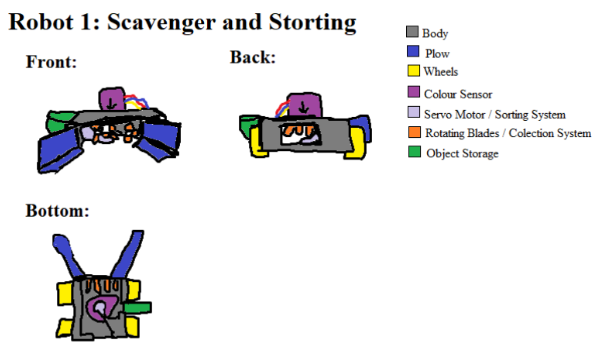
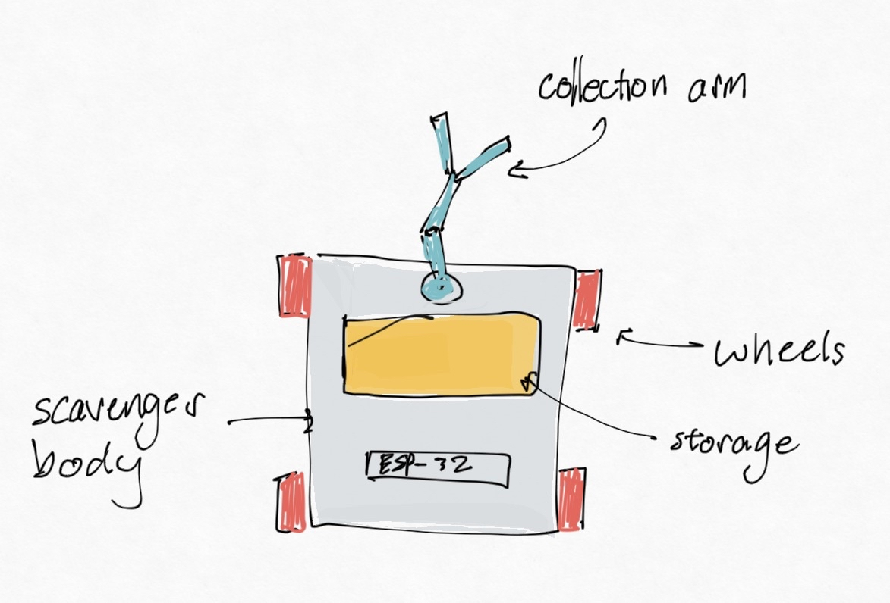
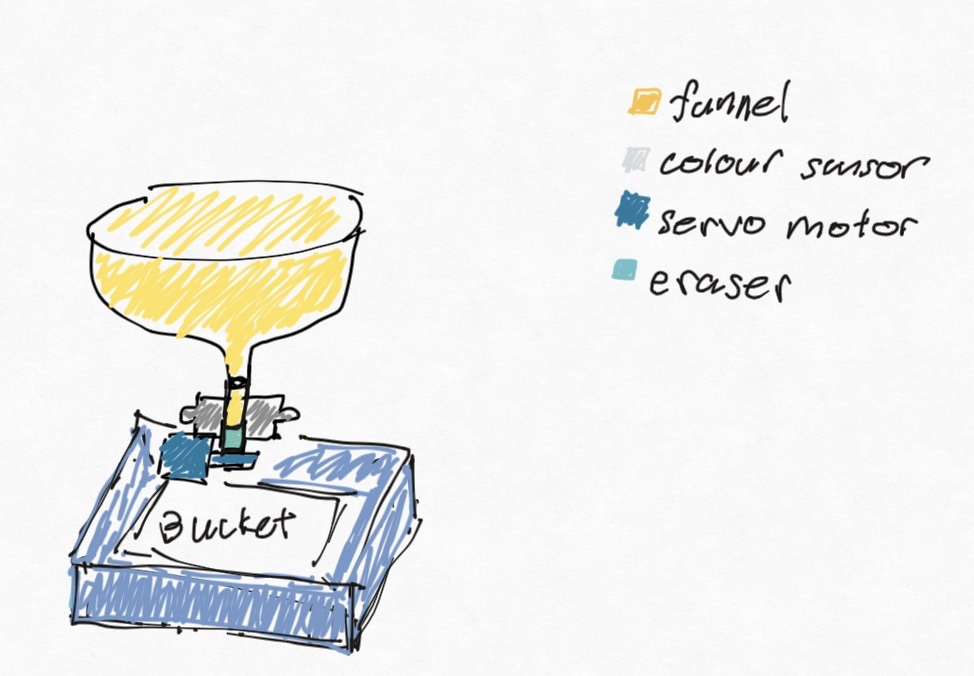
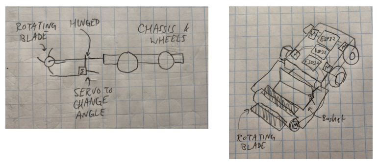
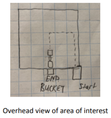
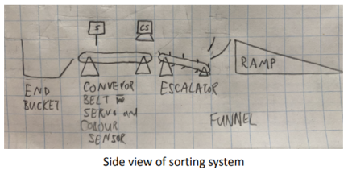
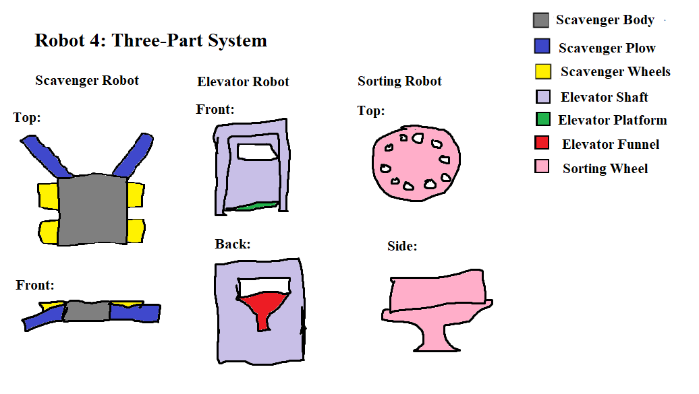

# Conceptual Design Requirements

The conceptual design of the robot was guided by several key requirements to ensure functionality, feasibility, and reliability that were determined in phase 1 under product design requirements and constraints.

- **Weight Distribution:** The robot must maintain balanced weight to ensure stability and prevent tipping.
- **Cost Efficiency:** The design must remain within the $50 budget while maximizing use of lab kit components.
- **Durability:** The system must withstand repeated testing and final demonstration without failure.
- **Portability:** The robot must be compact enough to fit within course storage constraints.
- **Reliability:** The robot must consistently perform navigation, collection, and sorting tasks.
- **Ease of Repair:** Components should be easily accessible for quick fixes.
- **Ease of Implementation:** The design must be achievable within the project timeline.
- **Scalability and Modularity:** Subsystems should be easily modified without redesigning the entire robot.

---

# Concept Generation

To systematically develop the overall design, the system was divided into four primary subsystems: drive, navigation, collection, and sorting. Multiple design options were considered for each subsystem.

---

## Drive Subsystem

### Wheels

#### 3D Printed Single Part Wheels
A one-piece TPU wheel directly attached to the motor, designed with a hollow structure to provide traction and flexibility for smooth movement. This design is easy to manufacture and modify; however, insufficient wall thickness or excessive load may cause deformation, reducing performance.

#### 2202 Lab Wheel
A lab-provided wheel with a 3D printed socket that attaches directly to the motor. It has a slim profile with sufficient traction, but the tire is prone to slipping due to limited support and low friction.

#### Two Part Wheel (Tire and Wheel)
The flat rubber tire wheel will be a two-part 3D printed wheel. The inner wheel will be made of PBC, a stronger material that can support more weight.

#### Lego Wheel With 3D Axel
A rubber lego wheel part with a 3D printed axel that will attach directly to the motor.

---

### Chassis

#### Square Chassis
Offers good space and clear orientation, but protruding corners during turns increase collision risk.

#### Circle Chassis
Allows smooth rotation without protruding corners, reducing collision risk. However, it lacks clear orientation and offers slightly less surface area for components.

---

### Steering

#### Differential Drive
Every wheel has its own DC motor, allowing more driving power.  
Requires more motor driver boards.

#### Tracked Drive (Tank Treads)
An alternative to the differential drive involves using a tracked system like a tank. One DC motor on each side is used to control the gears.

#### Front Wheel Drive
While four wheels are used while only the front two wheels are powered by DC gear motors. More effective for a robot that is weighted more to the front.

#### Rear Wheel Drive
Only back two wheels are powered by DC gear motors, front two wheels are unpowered. More effective for a robot that is heavier towards the back.

---

## Navigation Subsystem

#### Predetermined Path with Encoder Feedback
Uses motor encoders to follow a fixed path with PID control to correct drift.

#### Accelerometer
Provides real-time motion feedback to improve position accuracy and correct deviations.

#### IR Detection Beacon
Uses an IR sensor to locate the base station and guide the robot back.

#### Ultrasonic Sensor
Detects obstacles and measures distance to prevent collisions.

#### LiDAR
Offers precise environment mapping but is impractical due to high cost and complexity.

---

## Collection Subsystem

#### Plow Attachment
Pushes multiple objects forward into a collection area.

#### Collection Arm with Claw
Grabs individual objects and places them into storage.

#### Rotating Blades
Uses a motor-driven mechanism to sweep objects into the robot.

---

## Sorting Subsystem

#### Elevator Into Funnel and Rotation Wheel System
Objects are sent into an elevator system where the objects are dropped into a funnel and individually sensed by a colour sensor and path is determined by a servo.

#### Conveyor and Servo Motor System
Objects are directed into a conveyor system one by one by servo motors, conveyor then runs objects under colour sensor and either knocked off or kept on by a servo.

#### Onboard Servo Sorting System 
As objects are collected a colour sensor will run over each object and either rejected back into arena or kept onboard

---

## Full Robot Designs

### Concept Idea 1: Single Scavenger and Sorting Robot

This concept combines object collection and sorting into a single autonomous robot. The robot follows a predetermined path using encoder feedback and uses a front-mounted plow that guides objects into an internal rotating blade mechanism to collect objects into an internal storage compartment. 

An internal colour sensor and servo system sort objects in real time during collectgion, ejecting non-valuable items and storing valuable ones. The design uses lightweight 3D printed wheels and a front-wheel drive system to improve traction and control. 

At the end of operation, the robot returns to the base station and deposits all stored valuable objects. 

*Figure: Conceptual design of the scavenger and sorting robot (front, back, and bottom views).*

### Concept Idea 2: Two-Part Scavenger and Sorting Robot with Collection Arm

 

This concept separates collection and sorting into two systems: a mobile scavenger robot that manually picks up objects and a stationary base station sorting system.

The scavenger robot navigates the environment using encoder-based pathing and collects objects with a front-mounted arm when the ultrasonic sensor detects an object infront of the robot, the arm then moves the objects into a storage ontop of the robot and then conitnues its parth. Unlike Concept Idea 1, no sorting is performed during collection.

Once the collection phase is complete, the robot returns to the base station and deposits all collected objects into a funnel. The stationary sorting system then processes the objects using a colour sensor and servo mechanism, separating valuable and non-valuable items into designated locations.

### Concept Idea 3: Two-Part Scavenger and Sorting Robot with Plow and Rotation Blades

This concept separates the system into a mobile scavenger robot that has rotory blades to push objects into it's plow and a stationary sorting robot positioned near the end bucket.

The scavenger robot begins at the bottom right corner of the area and follows a predefined path using encoder feedback. The path consists of straight motion and 90° turns to systematically cover the area and deliver collected objects to the sorting system. An accelerometer is used alongside encoder data to improve turning accuracy through PID control.

The robot uses a rectangular chassis with four wheels, each driven by a DC gear motor to enable differential drive. A front-mounted plow is used for collection, remaining flush with the ground during operation. A rotating blade mechanism assists in sweeping objects into the plow.

During unloading, the robot climbs a ramp and adjusts the basket angle using servo motors to release objects into a funnel. The funnel directs objects into an escalator system with slots that isolate individual items.

At the top of the escalator, objects are transferred onto a conveyor belt. A colour sensor identifies each object, and a servo mechanism determines its destination. Invalid objects are pushed off the conveyor, while valid objects continue into the end bucket.

*Figure: Scavenger robot design with rotating blade collection system.*

*Figure: Overhead view of the operating area and robot path.*

*Figure: Side view of the sorting system including funnel, escalator, and conveyor.*

### Concept Idea 4: Three-Part Scavenger, Elevator, and Sorting Robots with Collection Plow and Rotating Sorting Wheel

This concept further separates the system into a mobile scavenger robot that simply plows the objects into an open elevator shaft where the elevator would drop the objects into a rotating sorting wheel.

The scavenger robot would use rectangular chassis with four wheels, only the front two wheels would have DC motors as the robot would inherently be front heavy and be able to take advatange of the front wheel drive.A front-mounted plow is used for collection, staying flush with the ground during driving. The robot would navigate the arena by a predetermined path consisting of straight motion and 90° turns to systematically cover the area and push the objects in the front of the plow to the enterance of the elevator system.

Once the objects were in the shaft of the elevator the system would raise the objects up and into a funnel system. The funnel system would then deposite the objects into a funnel and funnel the objects indevidually into a rotating sorting wheel. The sorting wheel would pass under a colour sensor where it would check the colour of each object and either allow the object to stay in the wheel and drop the object into the end bucket or it would prematurely drop the object off the mechanism. 

*Figure: Conceptual design of the scavenger, elevator and sorting robots (including all important views for each robot).*
