# Product Generation

---

## Initial Harvesting Design Concept

At the early stages of development, a harvesting-based collection system was explored as an alternative to the plow design. This concept involved a motor-driven rotating blade mechanism positioned at the front of the robot, intended to actively sweep objects into an internal storage compartment.

The harvesting system was first developed through CAD modeling to evaluate feasibility and integration with the robot chassis. Several design iterations were created to refine the geometry, blade positioning, and intake path of objects. These iterations aimed to improve collection efficiency and ensure consistent object intake without jamming.

However, during evaluation, several limitations of the harvesting system were identified. The design introduced significant mechanical complexity, requiring additional motors, precise alignment, and more advanced control. This increased the likelihood of failure and made the system more difficult to implement within the given time and budget constraints.

Additionally, the harvesting mechanism was less reliable during early testing and posed challenges in maintaining consistent object flow into the storage compartment.

As a result, the harvesting concept was ultimately discarded in favor of the plow-based collection system. The plow design provided a simpler, more robust, and easier-to-implement solution while still achieving effective object collection.

This decision reflects a trade-off between complexity and reliability, with priority given to a design that could be consistently executed and tested within project constraints.

## Initial Harvesting Design Concept

At the early stages of development, a harvesting-based collection system was explored as an alternative to the plow design. This concept used a motor-driven rotating blade mechanism to actively sweep objects into the robot.

---

### Iteration 1 – Initial Harvester Design

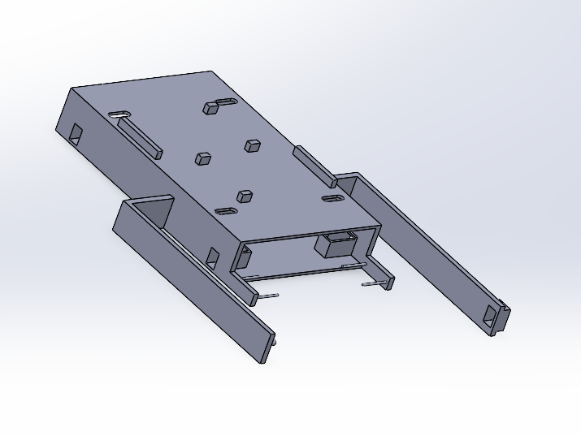

| Features | Issues |
|----------|--------|
| - Rotating blade mechanism for active intake - Large chassis to accommodate harvesting system | - Chassis size was too large, making the robot difficult to maneuver - Increased weight reduced efficiency and control - Not feasible within size constraints |

---

### Iteration 2 – Refined Harvester Design

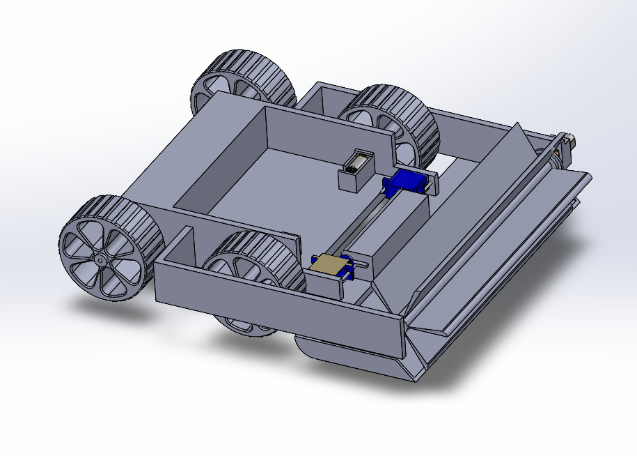

| Features | Improvements |
|----------|-------------|
| - Reduced chassis size - Improved blade positioning and intake geometry | - Still mechanically complex - Required additional motors and precise control - Increased risk of failure and difficult to implement reliably |

## Design Decision

Although the second iteration improved the overall size and layout, the harvesting system remained complex and difficult to implement within the project constraints. The added mechanical components increased the likelihood of failure and required more precise control than feasible.

As a result, the harvesting concept was abandoned in favor of the plow-based collection system. The plow provided a simpler, more reliable, and easier-to-implement solution while still achieving effective object collection.

This decision prioritized simplicity, reliability, and feasibility, ensuring consistent performance during testing and final implementation. 

---

## Design Iterations & Refinement (FINAL DESIGN)

### Chassis Iterations

The chassis design underwent multiple iterations to improve clearance, component placement, and overall system integration.

#### Iteration 1 – Initial Chassis Design

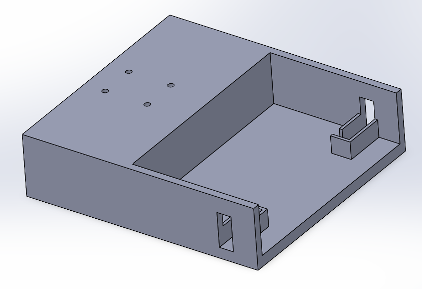 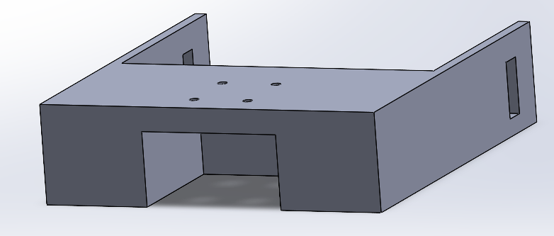

| Features | Issues |
|----------|--------|
| - Compact rectangular chassis - Removed back wheels for caster wheel - Better ability to turn | - Insufficient clearance for rear caster wheel - Caster interfered with movement - Limited space for electronics (ESP32 and battery) |

---

#### Iteration 2 – Revised Chassis Design

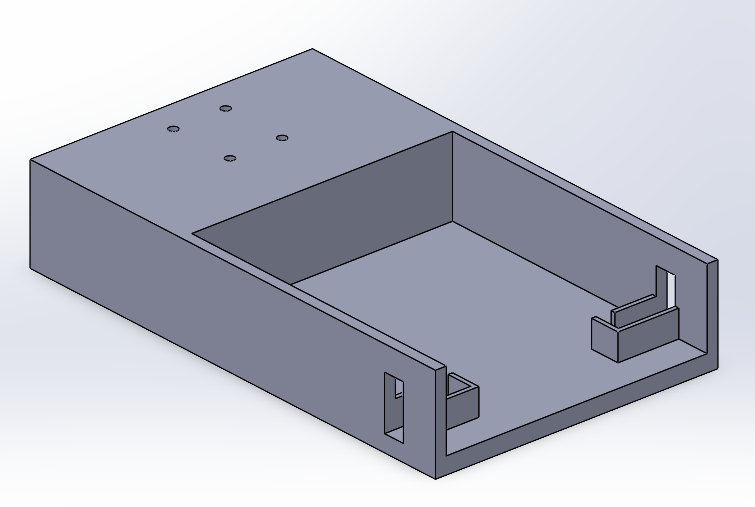 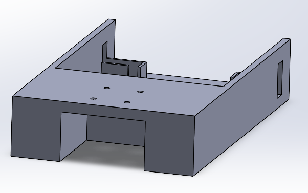 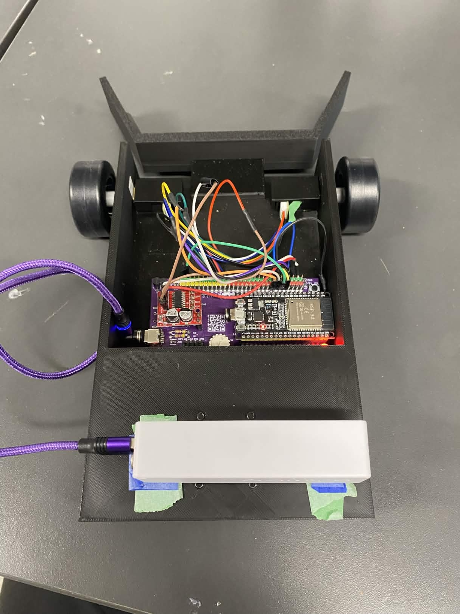 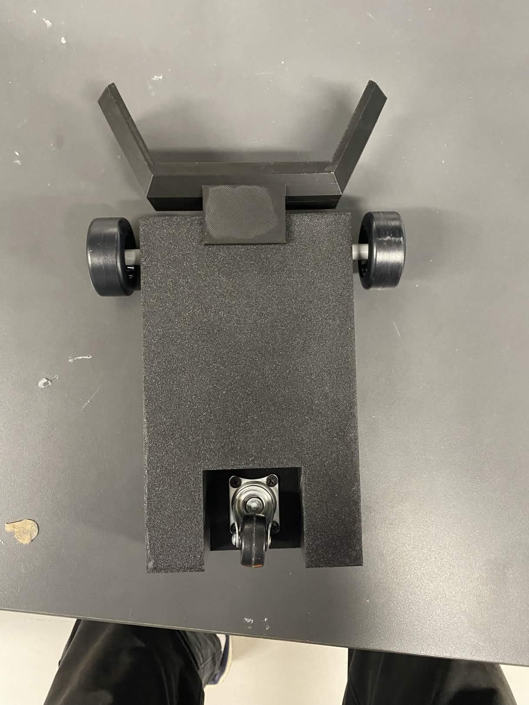 

| Features | Improvements |
|----------|-------------|
| - Increased chassis length - Added clearance for rear caster wheel - More space for ESP32 and battery placement - Full ability to make turns | - Improved maneuverability with proper caster function - Better organization and mounting of electronic components |

---

### Plow Iterations

#### Iteration 1 – Initial Design

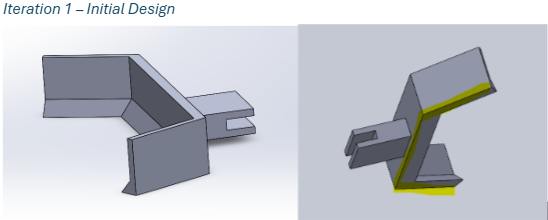

| Features | Issues |
|----------|--------|
| - Basic flat plow attached to front - Designed to push objects forward | - Robot cannot drive due to friction caused by the flat base |

#### Iteration 2 – Angled Plow (Final)

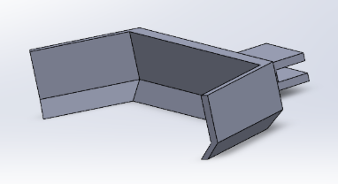

| Features | Improvements |
|----------|--------|
| - Added angled sides to reduce friction | - Improved maneuverability and maintained traction |

---

### Wheel Iterations

#### Iteration 1 – 3D Printed Wheels

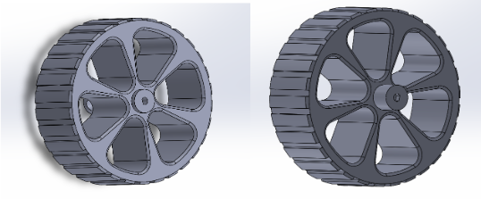

| Features | Issues |
|----------|--------|
| - Lightweight hollow structure - Direct motor attachment - Customizable | - Insufficient strength - Risk of slipping - Inconsistent traction |

#### Iteration 2 – Lego Wheels (Final)

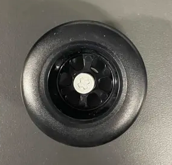 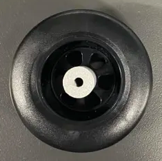 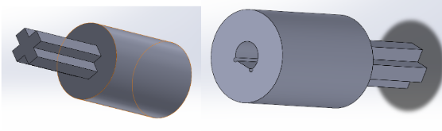

| Features | Improvements |
|----------|-------------|
| - Stable and reliable - Better motor grip - Rubber band added for controlled traction | - Improved turning and reduced slipping |

---

### Elevator System Iterations

#### Iteration 1 – 3D Printed Eveator Shaft

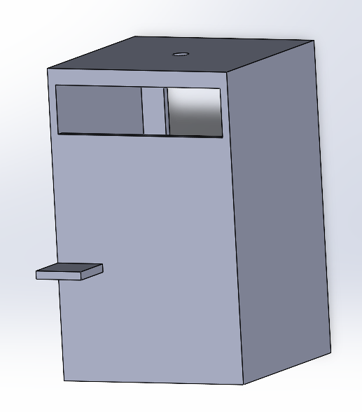

| Features | Issues |
|------|----------|
| - Rigid elevator - Precise dimensions | - Unable to print with 3D printer size limitation |

#### Iteration 2 – Cardboard Box

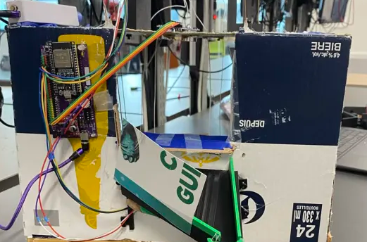

| Features | Issues |
|----------|-------------|
| - Large enough to fit scavenger robot - Easily adjustable material | - Too short to elevate objects high enough to dump into funnel system |

#### Iteration 3 – Cardboard Box With Wooden Supports
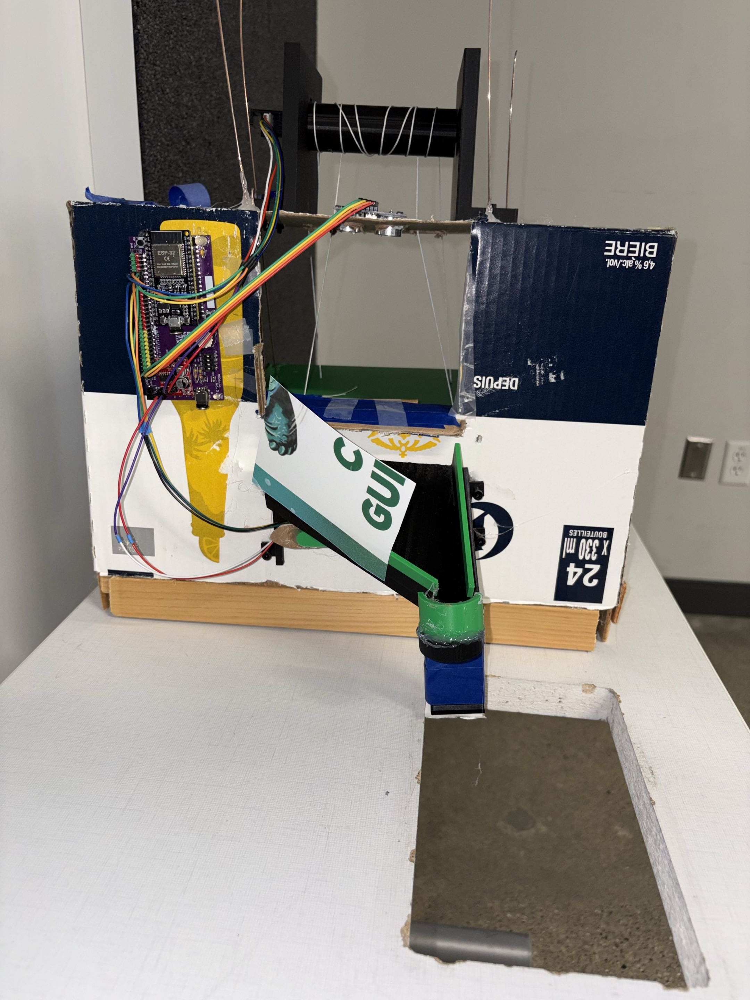

| Features | Improvements |
|----------|-------------|
| - Large enough to fit scavenger robot - Easily adjustable material| - Tall enough to dump objects into funnel system |
---

#### Platform Iterations

**Iteration 1 – Paper Platform**

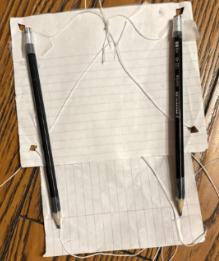

| Features | Issues |
|----------|--------|
| - Thin and lightweight - Allowed robot to drive onto platform | - Weak structure - Unstable surface - Poor durability |

**Iteration 2 – Final Platform**

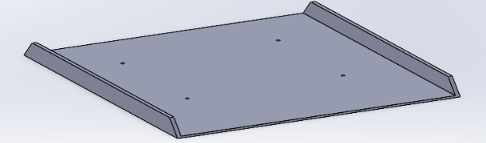 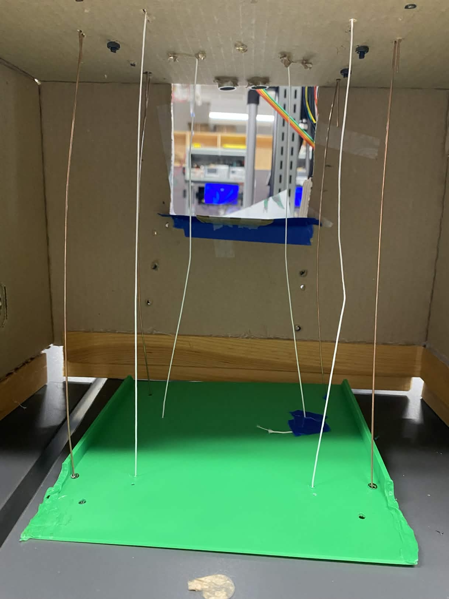

| Features | Improvements |
|----------|-------------|
| - Rigid 3D printed design - Side walls added - Stable surface - holes for wires in each corner | - Improved durability and object control |

---

### Pulley System Iterations

#### Iteration 1 – Initial Pulley Design

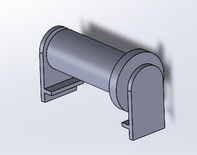

| Features | Issues |
|----------|--------|
| - Designed for integration with 3D printed elevator base - Compact pulley layout - Intended for precise lifting | - Not compatible with later cardboard base design - Less stable under load - Alignment issues during operation |

#### Iteration 2 – Revised Pulley Design

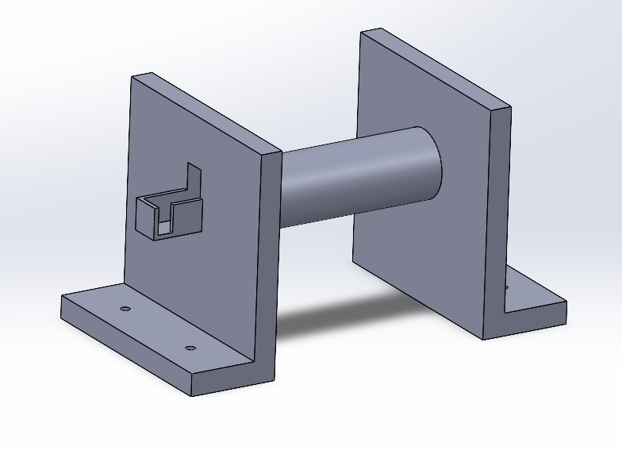 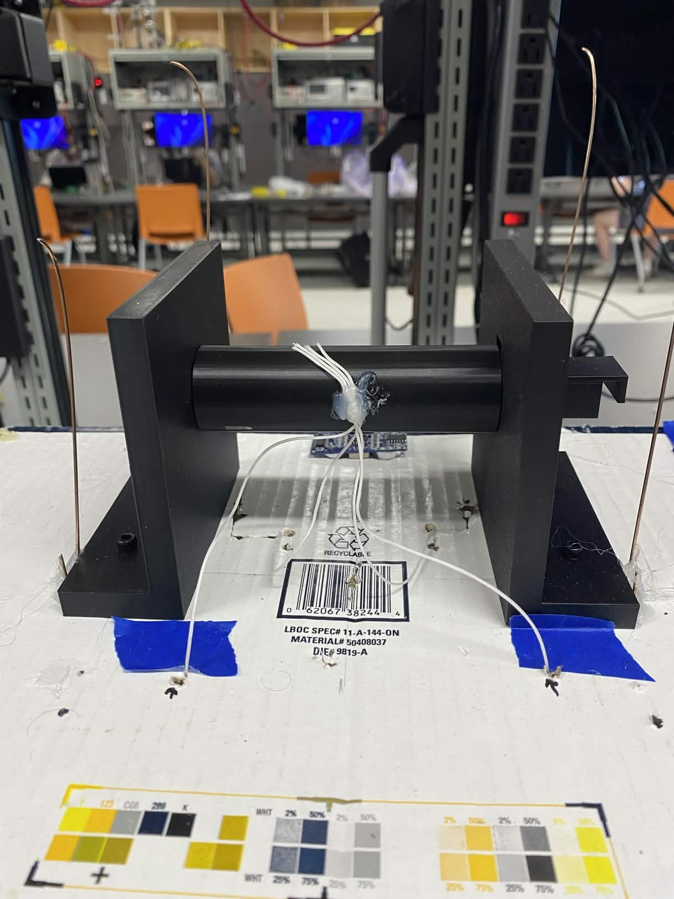 

| Features | Improvements |
|----------|-------------|
| - Adapted for cardboard elevator base - Improved stability and alignment - More robust mounting | - More reliable lifting performance - Better integration with final system - Reduced mechanical issues during operation |

---

### Funnel System Iterations

#### Iteration 1 – Initial Funnel Concept

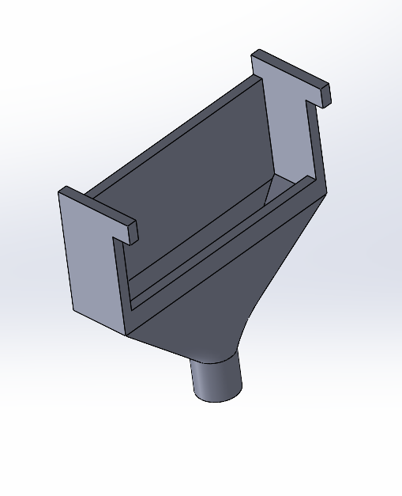

| Features | Issues |
|----------|--------|
| - Designed to integrate with 3D printed elevator base - Direct funnel path into sorting system | - Required agitation for objects to move consistently - No feasible way to implement agitation with this design - Objects frequently became stuck - Incompatible with later design changes (cardboard elevator base) |

#### Iteration 2 – Initial Funnel

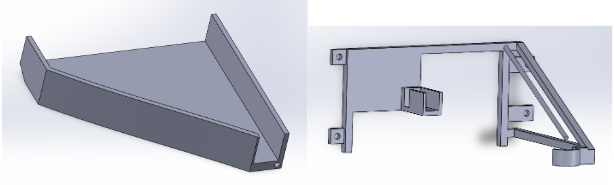

| Features | Issues |
|----------|--------|
| - Guided objects into sorting system - Included mounting support | - High friction - Frequent jamming - Weak components |

#### Iteration 3 – Final Funnel System

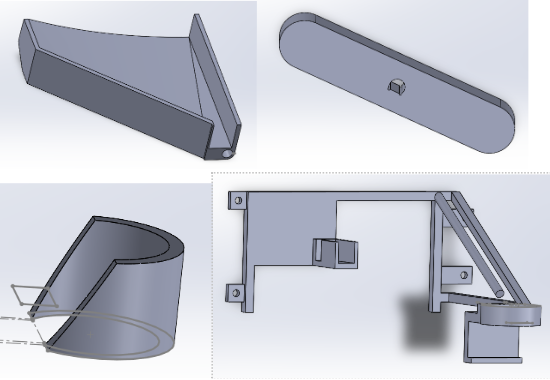 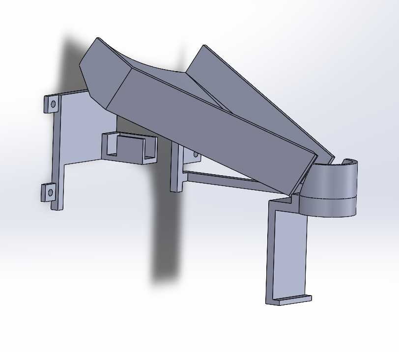

| Features | Improvements |
|----------|-------------|
| - Curved funnel - Funnel flipper mechanism - Reinforced mount - Metal support rod | - Reduced jamming - Improved flow and alignment - Increased durability |

### Sorting Device Iterations

The sorting device maintained a consistent rotating wheel mechanism across all iterations, while the supporting structure (wheel stand) was refined to improve reliability and integration of components such as the servo motor and colour sensor.

---

#### Iteration 1 – Initial Stand Design

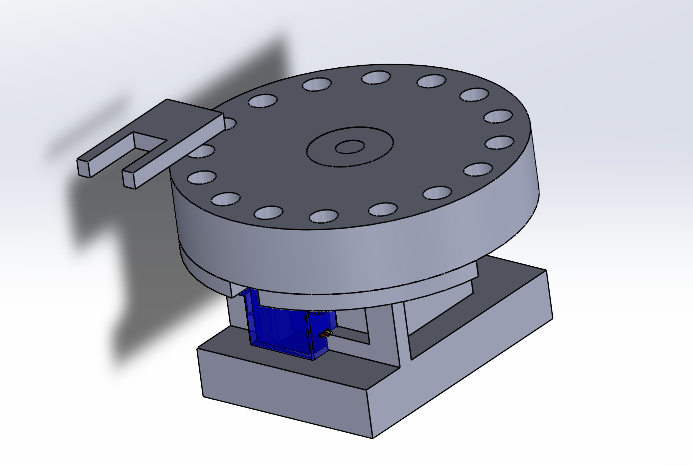

| Features | Issues |
|----------|--------|
| - Rotating wheel with basic stand support - Servo motor for sorting gate - Colour sensor mounted to structure | - Servo motor frequently jammed during operation - Colour sensor difficult to mount securely - Poor alignment between components |

#### Iteration 2 – Revised Stand Design

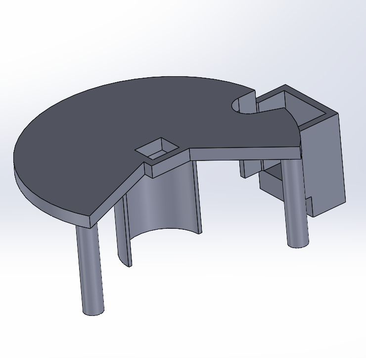

| Features | Issues |
|----------|--------|
| - Modified stand for improved component placement - Adjusted mounting for sensor and servo | - Servo motor continued to jam - Structural improvements were insufficient to resolve alignment issues |

#### Iteration 3 – Final Stand Design

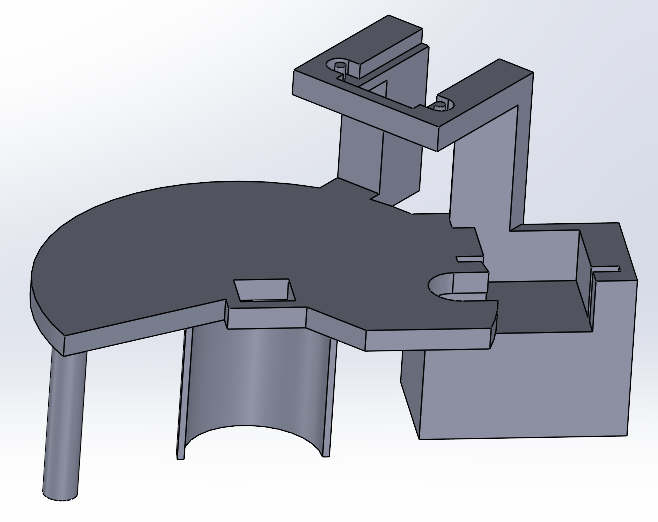 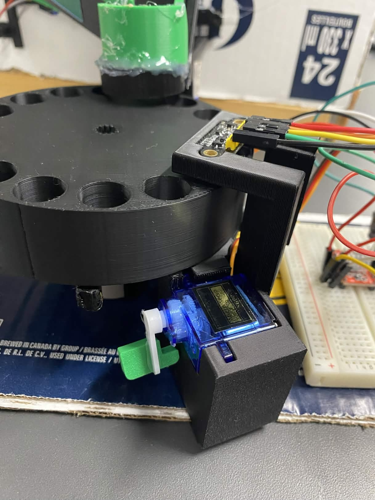 

| Features | Improvements |
|----------|-------------|
| - Redesigned stand for proper alignment - Improved mounting for servo and colour sensor - More stable structure | - Eliminated servo jamming - Secure sensor placement - Reliable and consistent sorting performance |

---

### Initial Sorting System Assembly (3D Printed Elevator Base)

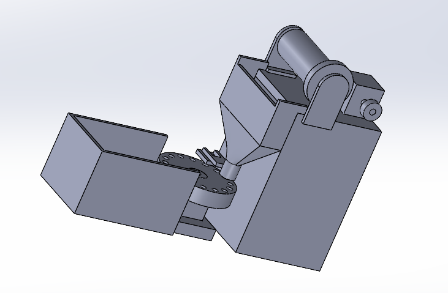

This assembly shows an earlier system configuration using the 3D printed elevator base integrated with the initial sorting device design.

In this configuration, the elevator base, sorting wheel, servo motor, and colour sensor were combined into a single structure. While this design allowed for full system integration, it introduced several challenges related to alignment, stability, and component mounting.

| Observations | Issues |
|-------------|--------|
| - Fully integrated 3D printed structure - Elevator and sorting system combined into one assembly | - Difficult to align components precisely - Servo motor prone to jamming due to misalignment - Colour sensor difficult to mount securely - Limited flexibility for adjustments and modifications |

---

### Design Insight

This early assembly highlighted the limitations of relying solely on a fully 3D printed integrated structure. As a result, the design was revised to use a more modular approach, incorporating a cardboard base and improved mounting methods. This allowed for easier adjustments, better alignment, and more reliable system performance.

--- 

### Assembly and Manufacturing Constraints

The time manufacturing constraint for our group was not as large as it may have been for other groups due to the fact that we had access to an at home 3D printer. Dispite this we still had to wait hours between design iteration/fixes to test new versions of parts while they were being printed. The larged manufacturing constraint was the size limit of the 3D printer. The maximum size that the pritner could print at was 25cm^2, since our original design for the 3D printed elevator was larger than this we had to come up with a new idea for the elevator (the cardboard elevator). 

While creating each part in CAD we always made sure to keep in mind assembly. The implications on our design that this had was for any part (chassis, pully, funnel bracket) with the use of a DC motor we had to create a open top slot for the motor and a septerate cover for the motor slot that would friction fit over the motor. Another implication was the connection of the plow to the chassis. Since printing the chassis with the plow attached would be to large for the printer we had to create a friction fit slot to attach the plow to the front of the chassis. The pulley also had to be seperated into three parts to allow for free rotation, these parts were: a left bracket, a right bracket and a pulley tube. Similar to the pully the funnel also had to be seperated into three parts, a bracket to attach the funnel to the elevator, the funnel itself that could slot into a extending cylinder from the bracket, and the funnel cup that would be super glued onto the front of the bracket to prevent the funnel from falling off of the front of the cylinder.  

--- 

## Plow-Based Scavenger with Stationary Sorting System (Final Design)

This concept consists of a mobile scavenger robot and a stationary sorting system located at the base station. The scavenger robot is responsible for navigating the arena, collecting objects, and transporting them back to the sorting system, while the stationary system handles object separation and final deposit. 

The scavenger robot uses a rectangular chassis with front-wheel drive and a rear caster wheel to improve maneuverability and reduce turning friction. Navigation is based on a predetermined path using encoder feedback, allowing the robot to travel through the collection area in a controlled and repeatable manner. A front-mounted plow is used as the collection mechanism, angled inward to guide objects toward the center and push them into the robot’s storage area during forward motion. This design was selected for its simplicity, reliability, and ease of implementation compared to more complex intake mechanisms. 

Once the scavenger robot completes its collection route, it returns to the base station and deposits the collected objects into the sorting system. An elevator mechanism lifts the objects and transfers them into a curved funnel, which guides them downward into the sorting stage. A funnel flipper, driven by a DC gear motor, is used to agitate the objects and prevent jamming, while a reduced-size funnel cup helps ensure that the erasers remain upright as they enter the system. 

After exiting the funnel, the erasers enter a rotating sorting wheel driven by a stepper motor. The wheel indexes each eraser into position beneath a colour sensor, which determines whether the object is green. If the eraser is identified as green, a servo motor actuates to block its exit, allowing it to continue along the wheel and be directed into the designated collection bucket. If the eraser is not green, the servo does not actuate, and the object falls out through an opening, effectively separating non-valuable items. 

This design separates collection and sorting into two subsystems, reducing mechanical complexity on the mobile robot while improving reliability, accuracy, and ease of testing. 

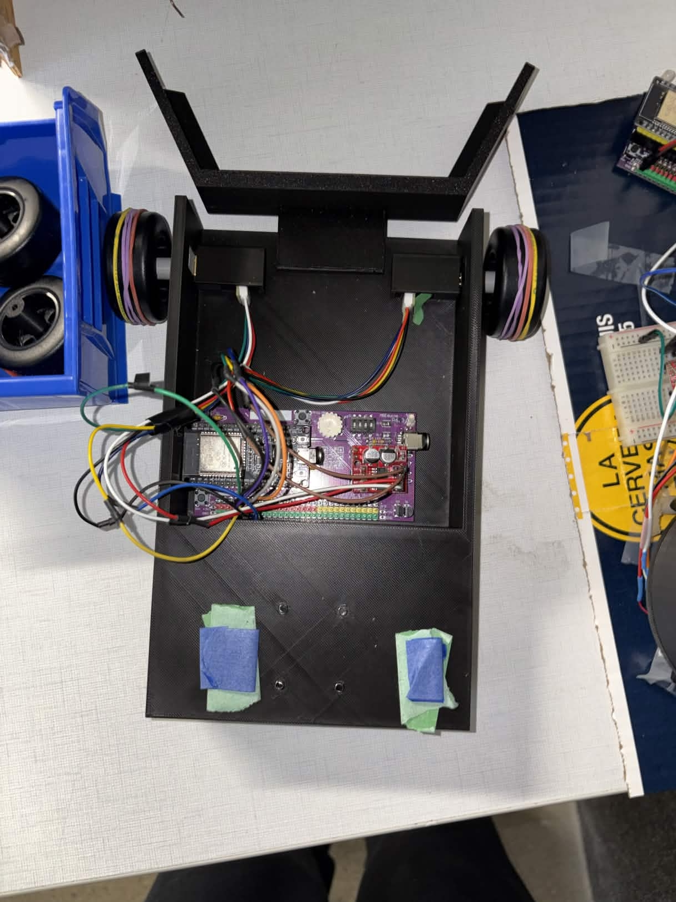 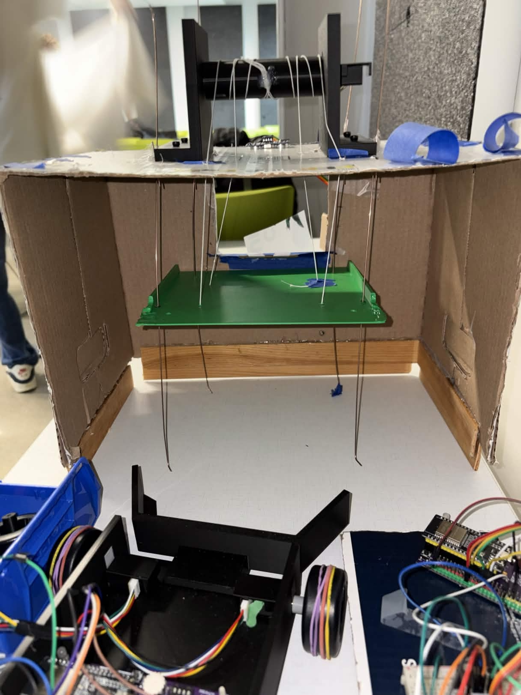 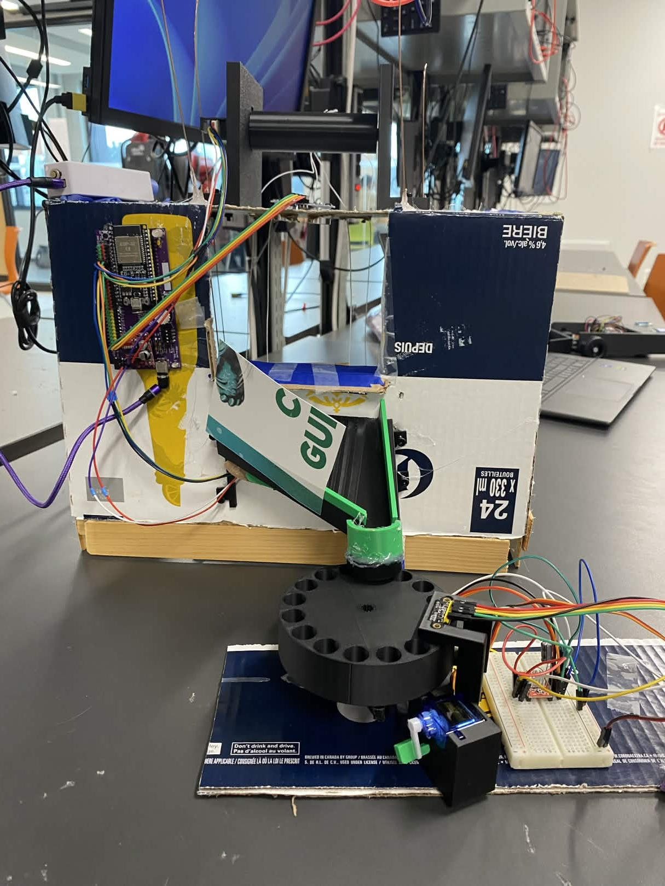

## Overall System Workflow

The following flowchart describes the sequence of operations of the robot from start to completion.

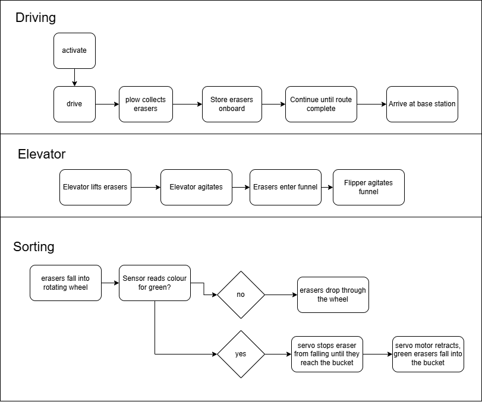
